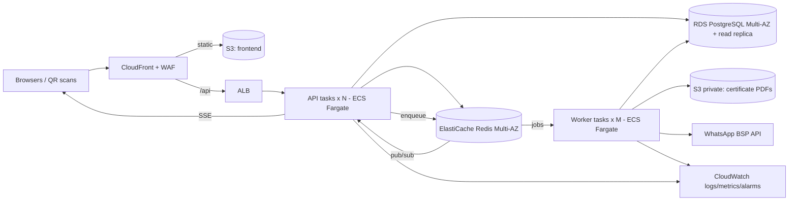

# Deployment plan (AWS ap-south-1; any cloud works the same)

Load: 100k users, ~10k DAU; peak = 500 batches approved in 1 h → 30,000 PDFs + 30,000 WhatsApp messages; verification: thousands/day in bursts.

## Architecture

Event flow: approve (DB commit) → `issue` job per certificate (BullMQ/Redis) → worker: PDF → S3 → WhatsApp → mark SENT → pub/sub event → SSE to browsers.

## Hosting and why
| Component | Host | Why |
|---|---|---|
| Frontend | S3 + CloudFront | Static, cheap, global cache |
| API | ECS Fargate behind ALB, autoscale on CPU/requests (min 3 across 2 AZs) | Stateless; scale by adding tasks |
| Workers | ECS Fargate, autoscale on **queue depth** | Throughput = workers × concurrency |
| PostgreSQL | RDS Multi-AZ (db.m6g.large), 1 read replica for verification/list reads | Needs transactions/locks; Multi-AZ failover |
| Redis | ElastiCache Multi-AZ (AOF/replication) | Queue + cache + pub/sub; see failure notes |
| PDFs | S3 private bucket, SSE-KMS | Cheap, durable |

## Scaling and peak
- Horizontal: API, workers, CloudFront. Vertical-ish: Postgres primary (writes), Redis.
- 30,000 PDFs/h ≈ 8.4/s. pdfkit ≈ 30–50 ms/PDF ⇒ one task with concurrency 10 ≈ 100+/s CPU-wise, so **WhatsApp provider rate limit is the real bottleneck** (BSPs typically allow tens of msgs/s per number; 8.4/s sustained is fine, bursts need the queue). Use 4–6 worker tasks at peak; add a rate limiter on the queue matching the BSP quota.
- Backlog clearing: queue absorbs bursts; autoscale workers on depth; the sweeper re-queues anything undelivered (1000/min cap protects the provider).
- DB at peak: ~8 writes/s per cert phase + approvals — trivial. Batch approval inserts up to 2000 certificates in one statement.
- Verification: CloudFront can cache NOT_FOUND briefly; valid results cached 30 s in Redis (cancel overwrites instantly); per-IP rate limit; reads can go to the replica.

## Failure handling
- **Worker crash:** BullMQ marks the job stalled and another worker retries; delivery is idempotent (PDF temp+rename, provider idempotency key, skip if SENT).
- **Redis restart:** AOF + Multi-AZ failover. Committed certificates are in Postgres; the sweeper re-queues undelivered ones after 60 s. Verification falls back to the DB; rate-limit fails open; SSE reconnects automatically (UI refetches).
- **WhatsApp outage:** jobs retry with backoff, then mark FAILED; sweeper re-queues 1000/min; alert on failure rate; candidates can also download via the SMS/email fallback link (future).
- **Slow database:** pool limits + statement timeouts; API sheds load via ALB 5xx alarms; read traffic moved to replica; workers back off naturally because they await DB.
- **Instance restart anywhere:** no state in processes; migrations under advisory lock.

## Certificate storage and access control
PDFs in a private S3 bucket (no public ACLs, SSE-KMS). Access only via the API (`/c/:token/pdf` streams or issues a 5-minute presigned URL after checking status). 192-bit random token; cancelled → 410. Serial numbers come from a DB sequence.

## Monitoring and alerting
Structured JSON logs (pino) with request ids → CloudWatch. Metrics/alarms: API p95 latency & 5xx; queue depth and oldest-job age; certificate FAILED count; WhatsApp error rate; batches STUCK (escalated); RDS CPU/connections/replica lag; Redis memory/evictions. Page on: oldest job age > 15 min, FAILED > 1%, 5xx > 2%. Trace one batch via `audit_log` timeline.

## Rough monthly cost (USD, order of magnitude)
| Item | ~$ |
|---|---|
| Fargate API 3×(0.5 vCPU/1 GB) | 45 |
| Fargate workers 2 base (+ peak bursts) | 40–80 |
| RDS m6g.large Multi-AZ + replica | 300 |
| ElastiCache 2× cache.t4g.small | 50 |
| ALB + CloudFront + S3 + logs | 60–100 |
| WhatsApp messages (240k/month × ~$0.01–0.02 template) | 2,400–4,800 |
| **Total infra** | **~$500–600**; messaging dominates |
Trade-offs: Multi-AZ + replica roughly doubles DB cost but avoids a single point of failure; a single smaller DB with no replica cuts ~$200 at higher risk. Fargate over EKS avoids cluster ops overhead.
