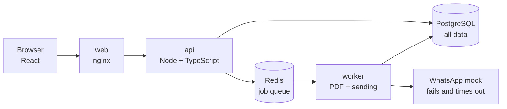

# CertiFlow: Skilling Certificate Issuance Platform

A platform where training centres send batches of passed candidates for approval, officers approve them, every candidate gets a certificate on WhatsApp, and anyone can check that a certificate is genuine.

Built for the Algohire hackathon (Pragati Skills Mission problem statement).

---

## 1. Requirements note (what we understood)

**The problem in one line:** certificates take weeks, nobody knows who approved what, and fake certificates are going around.

**Who uses it**

| Person | What they do |
|---|---|
| Training centre (Anika) | Uploads a batch of candidates and sends it for approval. Fixes it if it is sent back. |
| District officers (Dev, Meera, Kabir) | Review batches from their district. **Two different officers** must approve. |
| Quality team (Neha) | Extra check for **big batches (50 or more candidates)**. |
| State office (Farah) | Final approval. Sees stuck batches. Can cancel a certificate. |
| Candidate | Gets the certificate on WhatsApp and can download it. |
| Employer / public | Checks a certificate without logging in. |

**The approval path**

```
Draft -> District review (2 officers) -> [Quality review if 50+] -> State review -> Issuing -> Issued
```
An officer can also **approve**, **send back** (with a reason) or **reject** (with a reason).

**Decisions we made where the brief was not clear**

| Question in the brief | Our decision |
|---|---|
| What is "the spreadsheet"? | Candidate lists are uploaded as **CSV** (the standard export from Excel and Google Sheets). Columns: `name`, `phone`. |
| What is a "big batch"? | **50 or more candidates** go through the quality team. |
| How many district approvals? | **2**, from two different officers. The same officer cannot approve twice. |
| What happens to old approvals when a batch is sent back and resent? | **They are voided and review starts again.** The candidates changed, so earlier approvals no longer apply. The old approvals stay in the history for the record. |
| What counts as "stuck"? | A batch waiting too long with one step is **marked stuck and escalated to the state office** automatically. |
| What does the public see when checking a certificate? | Only: genuine or cancelled, serial number, a masked name (like "Asha R."), and the course. **Never the phone number.** |

---

## 2. How it works (simple version)

1. **Anika uploads a CSV.** The system checks **every row first**. If any row is bad, she sees the exact row numbers and errors, and **nothing is saved**.
2. **She sends the batch for approval.** Officers see it in their list with a "Needs you" tag.
3. **Two district officers approve.** If two click at the same moment, the batch still moves forward only once.
4. **Quality team approves** (only for 50+ candidates), then **state office approves.**
5. **On the final approval**, the system creates **one certificate per candidate** (each with a unique serial number like `PSM-2026-000001`) and puts one job per certificate on a queue.
6. **A background worker** takes each job, makes the PDF with a QR code, and sends the WhatsApp message. WhatsApp fails and times out often, so the worker **retries**, but each certificate still gets **exactly one** message.
7. **Anyone can verify** a certificate from the link or QR code. If the state office cancels it, the next check shows **Cancelled** immediately.
8. **Everything is recorded** in a history (who did what, and when), and the screen updates **live** without refreshing.

---

## 3. How it is put together



| Piece | What it does | Why it is there |
|---|---|---|
| **web** (React + Vite, served by nginx) | The screens people use | Simple, fast, and nginx also forwards `/api` to the backend |
| **api** (Node.js + TypeScript) | Rules, permissions, approvals, public verify page | One place that enforces who can do what |
| **PostgreSQL** | Stores batches, candidates, approvals, certificates, history | Needs real transactions and unique rules (no duplicate certificates) |
| **Redis + queue** | Holds the list of certificates waiting to be delivered | Slow or unreliable work (PDF, WhatsApp) never makes the user wait, and jobs survive a restart |
| **worker** | Makes PDFs, sends WhatsApp messages, retries | Can be scaled by running more copies |
| **WhatsApp mock** | Pretends to be WhatsApp: fails 20% of the time, hangs 15% of the time | There is no real WhatsApp account, so we test against something that behaves badly on purpose |
| **migrate** | Creates the tables and demo data at start-up | A fresh clone works with one command |

**Why a queue (events)?** When the state office approves 60 candidates, the page answers at once and the worker does the slow work in the background. If the worker crashes, the jobs are still waiting and another worker picks them up.

---

## 4. Key technical decisions and reasons

| Decision | Reason |
|---|---|
| **Check all CSV rows first, then save in one transaction** | "Nothing half-saved" |
| **Lock the batch row when an officer decides** | Two officers at the same moment can't move the batch forward twice |
| **Database rules for uniqueness** (one certificate per candidate, unique serial numbers) | The database enforces it, so a bug in code can't create duplicates |
| **Certificate id is used as the queue job id** | The same certificate can't be queued twice |
| **Certificate id is also sent as an idempotency key to WhatsApp** | If a message was delivered but the reply timed out, the retry does not send a second one |
| **Retries with growing wait times** (up to 20 tries) | Survives a failing provider without hammering it |
| **Random 64-character token on each certificate** | The public link can't be guessed or counted up |
| **Permissions checked on the server, not in the screen** | Hiding a button is not security. The server decides from the signed login token, never from what the browser says |
| **Public verify page reads the database every time (no cache)** | A cancelled certificate must never show as genuine |
| **Every decision goes into a history table** | Every decision can be traced to who made it and when |
| **Demo user switcher** | For reviewers only. It is not real login. In production this would be proper sign-in. |

---

## 5. Run it

You need Docker. From the project folder:

```bash
docker compose up --build
```

Then open **http://localhost:8080**.

- Delivered WhatsApp messages (from the mock): http://localhost:4010/sent
- Full steps, including starting from a fresh clone, are in [SETUP.md](SETUP.md).

**Run the tests:**

```bash
docker compose --profile test run --rm tests
```

---

## 6. Demo users

Use the "Demo user" dropdown at the top right. Sample data is loaded automatically.

| Name | Role |
|---|---|
| Anika | Training centre |
| Dev, Meera, Kabir | District officers (Hyderabad) |
| Neha | Quality team |
| Farah | State office |

**Quick try:** as Anika, create a batch from `frontend/public/sample.csv` and send it for approval. Then approve as Dev, then Meera, then Farah. Watch the certificates go from PENDING to SENT in the history. Click **Verify** on one, then cancel it as Farah and reload the verify page.

(A second centre user, Ravi, exists in the data only for the tests. It proves one centre cannot see another centre's batches.)

---

## 7. Tests

11 automated tests, all passing. Each proves one thing from the brief.

| Test | What it proves |
|---|---|
| 1. Bad rows | Exact row errors, nothing saved |
| 2. Two officers at the same moment | Batch moves forward once |
| 2b. Same officer twice | Second approval is refused |
| 3. 60 candidates | Quality step is required, 60 unique certificates, **one WhatsApp message each**, despite failures |
| 4. Cancel | Cancelled certificate is invalid for verifiers and downloads straight away |
| 5. Stuck batch | It is escalated to the state office without anyone chasing |
| 6. Return, fix, resubmit | Earlier approvals are voided and review restarts |
| Never-happen: bad or tampered login | Rejected |
| Never-happen: wrong role or wrong step | Cannot act |
| Never-happen: another centre | Cannot see or edit someone else's batch |
| Never-happen: public verify page | Leaks no personal data and cannot be enumerated |

There is also `scenarios.mjs`, a script that runs the main scenarios against the running system (`node scenarios.mjs`).

---

## 8. How we used AI

**Tools:** Claude (Anthropic).

**What AI helped with**
- The first version of the backend, worker, WhatsApp mock, frontend and tests.
- The new dashboard design (layout, approval tracker, stylesheet).
- Debugging Docker, Git and test problems.

**How we checked its output**
- Ran the whole stack with `docker compose up --build` and clicked through the full flow as each demo user.
- Ran the automated tests. Test 3 failed at first. We investigated and found the WhatsApp mock container had crashed and the queue was full of old failed jobs. After a clean restart (`docker compose down -v`) all 11 tests passed. The cause was our setup, not the code.
- Checked the database directly (`certificates` table) to see that retries really happened (38 of 84 certificates needed more than one try).
- Opened a certificate link from a WhatsApp message and confirmed it downloads a PDF without logging in.
- Where AI first guessed wrong about a problem (for example the cause of the failing test), we ran the checks first and only fixed what the output showed.

---

## 9. Known gaps and next steps (honest list)

- **CSV only.** Excel files must be saved as CSV first. Reading `.xlsx` directly is a next step.
- **Demo login is not real authentication.** A real version needs proper sign-in, password or OTP, and sessions.
- **Delivery after many failures.** A certificate that fails all its retries is marked FAILED. A background sweeper tries to re-queue it, but we did not test a long WhatsApp outage.
- **The WhatsApp mock container crashed once** during development and nothing restarted it. Adding `restart: unless-stopped` to the services is a next step.
- **Database tooling.** We use plain SQL migration files, not Prisma or Drizzle.
- **Not load-tested.** The 30,000 certificates in an hour plan is on paper only, see [DEPLOYMENT.md](DEPLOYMENT.md).
- **Editor warnings.** The frontend has no `tsconfig.json`, so VS Code shows red lines on the code. The app still builds and runs.

---

## 10. More documents

- [SETUP.md](SETUP.md): from a fresh clone to a running system
- [DEPLOYMENT.md](DEPLOYMENT.md): production plan for 100,000 users and results-day peak